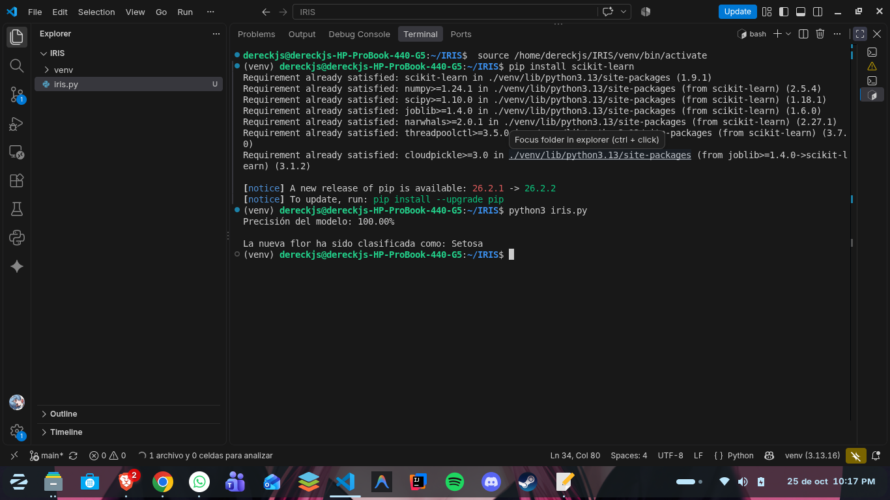

# Clasificador de flores Iris

## 1. Descripción del programa
Este programa entrena un clasificador de flores Iris con el conjunto de datos incluido en scikit-learn. Utiliza KNN (K-Nearest Neighbors, o K vecinos más cercanos) con 3 vecinos: compara las características de una flor con las muestras de entrenamiento más cercanas para predecir su especie. El conjunto se divide en datos de entrenamiento y prueba, y se calcula la precisión del modelo.

## 2. Instrucciones de instalación
Desde la raíz del proyecto, crea y activa un entorno virtual:

```bash
python3 -m venv venv
source venv/bin/activate
```

Instala scikit-learn dentro del entorno virtual:

```bash
pip install scikit-learn
```

## 3. Cómo probarlo
Con el entorno virtual activado, ejecuta el script desde la raíz del proyecto:

```bash
python3 iris.py
```

## 4. Explicación de la prueba


La captura muestra el porcentaje de precisión del modelo y la predicción final para una flor desconocida. En la prueba incluida, la muestra se clasifica como Setosa.

## 5. Conclusión
Este modelo de machine learning demuestra cómo KNN puede aprender a distinguir especies de Iris a partir de sus medidas. El resultado presenta la precisión obtenida en los datos de prueba y la especie predicha para una nueva muestra.
